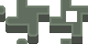
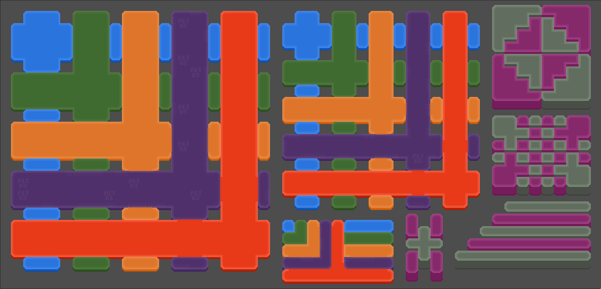
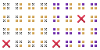

# A DualGrid Tilemap System Supporting Unlimited Adjacent Terrains

Adds a new `DualGrid` node (which extends `TileMapLayer`) to create a dual-grid tiling system for Godot which supports all mixes of adjacent terrains while still only requiring 29 unique tiles per terrain — **without requiring unique art for each bespoke mix**.

Bespoke mixes can be optionally added for any combination of two terrains. In the example project, this is configured for the Purple terrain mixing with the Orange terrain, and the Purple terrain mixing with the Red terrain. Tile variants are also fully supported.

This allows the following terrain sets to combine and create a world of endless terrain possibilities.

## Key Advantages Over Other Dual Grid Systems

Other Dual Grid implementations either require each unique terrain to sit on their own layer, require bespoke mixes for every unique combination of terrain, or achieve their visuals through complicated logic that's difficult to extend or directly interact with. This implementation aims to fix these problems, and offers the following key advantages:

- Supports unlimited terrain combinations while only requiring 29 unique tiles per terrain.
- Supports unlimited bespoke terrain combinations to override the default generic mix tiles.
- Supports variants of any tile.
- Easily supports overlaid tile art _(See example project usage)_.
- The `DualGrid` properties are passed through to each dynamically created child `TileMapLayer` which serve as the display layers, so they are still easily accessible.
- Particularly useful for sandbox games that need to support a large number of terrains potentially appearing next to each other.

## Example Project

This repository contains an example Godot 4.4 project [in /example/](/example/) with seven terrains already configured using the addon.

The example shows using the `LayerOrderOverrideRule` to create an exception to fix the example project's specific art.

The example Purple terrain shows two configured `BespokeMixRule` which set up the Purple terrain mixing with the Orange and Red terrains, as well as each unique kind of tile variant configured.

## Installation

Install the plugin by adding `addons/dualgrid` to your Godot Project, then in **Project Settings > Plugins**, enable DualGrid.

## Basic Usage

Configure your `DualGridTileSet` just as you would configure a normal `TileSet`, with **one terrain per tile source**, except that peering bits are not configured manually and are instead identified by tile position.

**Arrange each 4x4 dual grid tile set in a single horizontal row.** Each 4x4 dual grid tile set is identified by its x position offset as the **”Atlas Offset”**.

<table>
  <tr>
    <td align="center" width="50%"> <em>Tile guide. 16x16 tiles, with neighborhood indication.</em></td>
    <td align="center" width="50%"> <em>Example tile art template.</em></td>
  </tr>
</table>

- The first 4x4 tile set (atlas offset 0, the grid from `(0,0)` to `(3,3)`) is always the main terrain mixed with no other terrain. **This tile set is required.**
- The second 4x4 tile set (atlas offset 4, the tiles from `(4,0)` to `(7,3)`) is always the main terrain **”generic mix”** with any other terrain that does **not** have a bespoke mix. **This tile set is also required**.
- Additional bespoke mix and edge variant tile sets can occupy any atlas offset after the two required tile sets. 
- Bespoke mixes of two terrains can be configured in either terrain’s tile set. See **Configuring Bespoke Mixes**.
- The tile at `(2,1)` in each tile source is used as the full art tile for that terrain. All other tiles at _relative `(2,1)`_ in each 4x4 generic mix, bespoke mix, or any edge variant tile sets are **unused**.
- The tile at _relative `(0,3)`_ in each 4x4 dual grid tile set is **unused**, including in the two required tile sets.
- Full tile variants can occupy **any unused position**, as they are specified by their full atlas coordinates. See **Configuring Tile Variants**.
- Place tiles in the DualGrid using `DualGrid.set_world_tile` instead of `TileMapLayer.set_cell`, or by drawing any tile from a terrain's tile source in the `DualGrid` node via the editor.

For tiles that should not need to actually overlap with each other, no `LayerOrderOverrideRule` should be required. If your tiles might overlap with each other, for example, to create the illusion of depth or walls, you may need to create one or more `LayerOrderOverrideRule` depending on your specific art. You can see an example `LayerOrderOverrideRule` configuration [in the example scene](example/example.tscn).

_NOTE: The `LayerOrderOverrideRule` can be very confusing to configure without visuals. I recommend adding your art and placing a few different terrains next to each other in the `DualGrid` so you can visually identify cases where your art is ordered incorrectly, similar to the example project scene. Use the **Live Ordering Update Preview** to see your masking changes affect the `DualGrid` in real time. For a large `DualGrid`, toggle **Live Ordering Update Preview** to false and use the **Refresh Display Layer Preview** button, as each change recalculates the display tiles for the entire `DualGrid`._

If your tiles extend in the opposite direction as the example artwork, **Reverse Default Layering Order** can be used to flip the ordering.

To use physics layers from the Display Tiles, set **Display Collision Enabled** to true.

## Configuring Bespoke Mixes

**Bespoke mixes** are unique tile sets that **replace** the _generic mix_ edge tiles for the two specific terrains they are configured for. These allow you the **option** to create unique art for any specific transition, without the exponential art problem that requiring them creates.

Create a `BespokeMixRule` within your `DualGridTileSet` for each bespoke mix, where the **Primary Source ID** is also the tile source ID where the 4x4 bespoke mix is located, and the **Secondary Source ID** is set to the specific terrain that the primary source ID terrain is mixing with. Then, specify the **Atlas Offset** to locate that bespoke mix set within the terrain for that source ID. _In the example project, in the Purple tile source, the Orange bespoke mix is offset by 8 (the grid from `(8,0)` to `(11,3)`), and the Red bespoke mix is offset by 12 (the grid from `(12,0)` to `(15,3)`)._

## Configuring Tile Variants

Tile Variants can be configured to replace the art of any terrain via the `DualGridTileSet` resource. 

Configure full tile variants in the `TileVariantRule` **Full Tile Variant Atlas Coords** array by specifying the full atlas coordinates of each available alternative full tile.

Configure alternate edge and generic mix edge tile variants in the **Edge Variant Offsets** and **Generic Mix Edge Variant Offsets** arrays by specifying the atlas offset(s) of the 4x4 set(s) of variant edge tiles.

Configure Bespoke edge tile variants in the `BespokeMixRule` **Bespoke Mix Variant Offsets** array by specifying the atlas offset(s) of the 4x4 set(s) of variant bespoke edge tiles.

Variants are picked consistently for each world position, so they don't change when the display layers are refreshed or neighboring tiles are edited. Change the DualGrid's **Variant Seed** to get a different arrangement of variants.

How often each tile is picked is controlled by Godot's built-in `TileData` **Probability** property, which calculates relative probability from all available tiles. **Missing/empty tiles in each variant set are ignored**. For example, you do not need to create variants for an entire edge set to add a variant for a single edge tile if desired.

### Setting Tile Variant Probabilities

The full tile uses `(2,1)` and any **Full Tile Variant Atlas Coordinates** configured; edges tiles, generic mix edge tiles, and bespoke edge tiles use available tiles from their main set and any linked variant sets for each edge position. **Missing/empty tiles are ignored.**

To set a tile's probability in the editor:

1. Open the **TileSet** resource.
2. Select the terrain's tile source in the `TileSet`, switch to **Select** mode, and click on a tile or one of its variant tiles. Multiple tiles can be selected to edit them together.
3. In the tile's properties, expand **Miscellaneous** and set **Probability** (defaults to 1.0).
4. Press **Refresh Display Layer Preview** on the `DualGrid` to see the change, as probability changes don't refresh the preview automatically.

## Upgrading from Version 1 to Version 2

If you've already integrated version 1, here are some instructions to get your implementation updated to version 2. If this is your first time installing DualGrid, just follow **Basic Usage**.

1. Install and enable the new DualGrid addon, according to **Installation**. 
2. Rename `class_name DualGrid` from the old `dualgrid.gd` in your project to `DualGridOld` to prevent a class_name conflict. Update any references to `DualGrid` in your project to `DualGridOld`. This preserves existing functionality while you work through updating your integration.
2. Convert your `TileSet` resource to a `DualGridTileSet` resource. 
3. In your `DualGridTileSet`, transmute your `tile_mix_map` configurations into `BespokeMixRule`(s).
4. If you previously made any specific adjustments for edge cases similar to the example project, instead of editing the addon directly, configuring `LayerOrderOverrideRule`(s) for the `DualGrid` should be sufficient.
5. Replace your previous `DualGridOld` with new `DualGrid` nodes (now from the addon.)
6. Update any code using `set_cell` on the old DualGrid to `set_world_tile`.

## Contributing

I was inspired to create and post this project under the MIT license because of the dedicated and amazing Godot Community. I intend on using this system for several of my own projects, so I will be actively maintaining this repository for the forseeable future. I welcome any contributions from the community!

## License and Required Disclosures

### License
This project is released under the [MIT License](LICENSE)

### References
This project would not have been possible without other developers who created their own Dual Grid implementations and shared that code openly. They were a huge inspiration for this project!

- [Dual Grid Tilemap System for Godot in GDScript by GlitchedinOrbit](https://github.com/GlitchedinOrbit/dual-grid-tilemap-system-godot-gdscript)
- [Dual Grid Tilemap System in Godot by jess-hammer](https://github.com/jess-hammer/dual-grid-tilemap-system-godot)
- [TileMapDual by pablogila](https://github.com/pablogila/TileMapDual)
- [Jess::codes's "Draw fewer tiles - by using a Dual-Grid system" Video](https://www.youtube.com/watch?v=jEWFSv3ivTg)
- [This particular feature proposal comment in TileMapDual by megonemad1](https://github.com/pablogila/TileMapDual/issues/32)

## Credits

- [Exonfang](https://github.com/Exonfang) contributed the original DualGrid implementation and tile variant functionality.
- [Jesse-Goertzen](https://github.com/Jesse-Goertzen) contributed a significant refactor of the original DualGrid implementation into a proper addon, adding `BespokeMixRule`, `LayerOrderOrverrideRule`, and editor preview functionality.
